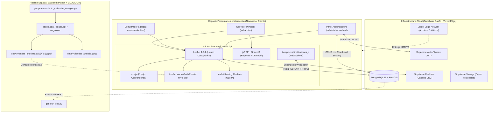

# MANUAL TÉCNICO Y DE PROGRAMACIÓN
## Arquitectura de Software, Geoprocesamiento y Especificación de Código del Geovisor de Sabaneta

**Autores del Proyecto:** Jacobo Flórez · Sebastián Zuleta · Ana Sofía Sáenz  
**Área Temática:** Sistemas de Información Geográfica (SIG) y Desarrollo Web Geoespacial  
**Repositorio Base:** `Visor_Geografico-2/visor-geografico`  
**Entorno Productivo:** [https://visorgeografico.vercel.app](https://visorgeografico.vercel.app)  
**Versión del Manual:** 2.5 (Edición Formal de Referencia de Código)

---

## ÍNDICE DEL MANUAL TÉCNICO

1. [VISIÓN GENERAL DE LA ARQUITECTURA](#1-visión-general-de-la-arquitectura)
   - 1.1. Paradigma Arquitectónico (Jamstack + BaaS + Pipeline Espacial)
   - 1.2. Diagrama de Arquitectura Global del Sistema
   - 1.3. Principios de Diseño y Patrones de Software Empleados
2. [PILA TECNOLÓGICA Y DEPENDENCIAS](#2-pila-tecnológica-y-dependencias)
   - 2.1. Bibliotecas del Cliente (Frontend)
   - 2.2. Plataforma Backend y Persistencia (Supabase Cloud)
   - 2.3. Herramientas de Geoprocesamiento y Conversión Espacial
3. [ESTRUCTURA DE DIRECTORIOS Y ORGANIZACIÓN MODULAR](#3-estructura-de-directorios-y-organización-modular)
4. [EXPLICACIÓN DETALLADA DE MÓDULOS DE CÓDIGO (JAVASCRIPT)](#4-explicación-detallada-de-módulos-de-código-javascript)
   - 4.1. `crs.js` — Motor de Proyecciones Cartográficas
   - 4.2. `supabaseClient.js` — Capa de Abstracción de Datos
   - 4.3. `layers.js` — Procesamiento y Normalización de Capas
   - 4.4. `instituciones.js` — Lógica de Negocio Escolar, Fichas y Rutas
   - 4.5. `vias.js` — Ingesta Paginada de la Malla Vial
   - 4.6. `viviendas.js` — Renderizado de Teselas Vectoriales y Filtros
   - 4.7. `visor-buscador.js` — Motor de Búsqueda y Animaciones Cartográficas
   - 4.8. `comparador-instituciones.js` & `comparador-pagina.js` — Analítica Gráfica
   - 4.9. `informes.js` — Motor de Reportes en PDF y Excel
   - 4.10. `mi-ubicacion.js` — Telemetría GPS con WatchPosition
   - 4.11. `analisis-cobertura.js` — Algoritmo de Déficit y Simulación de Sedes
   - 4.12. `herramientas-capa.js` — Geometría Computacional y Mediciones
   - 4.13. `tiempo-real-instituciones.js` — Suscripciones WebSockets y Polling
   - 4.14. `admin-ubicacion.js` & `admin-calificaciones.js` — Utilidades de Administración
5. [MODELO DE DATOS Y ESTRUCTURAS DE INFORMACIÓN](#5-modelo-de-datos-y-estructuras-de-información)
   - 5.1. Esquema Relacional en PostgreSQL / PostGIS
   - 5.2. Estructura de Capas en OGC GeoPackage (`viviendas_analisis.gpkg`)
   - 5.3. Especificación de Mapbox Vector Tiles (`.pbf`)
6. [PIPELINE DE GEOPROCESAMIENTO EN BACKEND (PYTHON + GDAL/OGR)](#6-pipeline-de-geoprocesamiento-en-backend-python--gdalogr)
   - 6.1. Flujo de Trabajo en `geoprocesamiento_viviendas_colegios.py`
   - 6.2. Reproyección Métrica a MAGNA-SIRGAS 2018 Origen Nacional (`EPSG:9377`)
   - 6.3. Generación Automatizada de Buffers OGR (150m, 300m, 500m)
   - 6.4. Cruce Espacial y Clasificación de Proximidad (*Spatial Join*)
   - 6.5. Compilación de Teselas Vectoriales con `gdal.VectorTranslate`
7. [ALGORITMOS CRÍTICOS Y FORMULACIÓN MATEMÁTICA](#7-algoritmos-críticos-y-formulación-matemática)
   - 7.1. Algoritmo de Detección Heurística de CRS
   - 7.2. Deduplicación Difusa de Registros con Coeficiente de Jaccard
   - 7.3. Ranking Bayesiano de Valoraciones Ciudadanas
   - 7.4. Geometría Esférica: Fórmulas de Haversine y Chamberlain–Duquette
8. [GUÍA DE PUESTA EN MARCHA DEL ENTORNO DE DESARROLLO LOCAL](#8-guía-de-puesta-en-marcha-del-entorno-de-desarrollo-local)
   - 8.1. Requisitos Previos e Instalación de Herramientas
   - 8.2. Clonación y Configuración del Repositorio
   - 8.3. Ejecución del Servidor Web Local
   - 8.4. Configuración del Entorno de Geoprocesamiento Python / GDAL
9. [DESPLIEGUE EN PRODUCCIÓN, INTEGRACIÓN CONTINUA Y MONITOREO](#9-despliegue-en-producción-integración-continua-y-monitoreo)

---

## 1. VISIÓN GENERAL DE LA ARQUITECTURA

### 1.1. Paradigma Arquitectónico
El proyecto está concebido bajo el paradigma **Jamstack** (*JavaScript, APIs, Markup*), combinando:
1. **Frontend Desacoplado y Ligero (Zero-Build):** Desarrollado en JavaScript puro (Vanilla ES6+), HTML5 y CSS3 nativo. No requiere transpiladores (Babel, Webpack o Vite) para ejecutarse en el navegador, eliminando la sobrecarga computacional en tiempo de despliegue.
2. **Backend-as-a-Service (BaaS) en la Nube:** Todos los servicios de base de datos relacional y geoespacial, autenticación de usuarios por tokens JWT y difusión en tiempo real son provistos por **Supabase** (PostgreSQL 15 + PostGIS).
3. **Pipeline de Geoprocesamiento Batch / Offline:** Un conjunto de scripts en Python potenciados por **GDAL/OGR** ejecutan las operaciones geoespaciales pesadas (reproyección cartográfica, cálculo métrico euclidiano de distancias, generación de buffers poligonales y teselado piramidal MVT), de modo que el cliente web solo consuma datos precalculados de alto rendimiento.

### 1.2. Diagrama de Arquitectura Global del Sistema



### 1.3. Principios de Diseño y Patrones de Software Empleados
- **IIFE (Immediately Invoked Function Expressions):** Cada script encapsula su lógica y variables privadas para evitar la polución del espacio global de nombres (`window`), exponiendo únicamente interfaces estrictamente necesarias.
- **Fail-Safe / Progressive Enhancement:** Si la base de datos o algún servicio externo no responde, el visor recurre a conjuntos de datos de respaldo locales en formato GeoJSON sin interrumpir la experiencia de usuario.
- **Separación de Responsabilidades (SoC):** La cartografía (Leaflet), las transformaciones matemáticas (Proj4js), la persistencia (Supabase) y la interfaz de usuario operan de forma desacoplada y modular.

---

## 2. PILA TECNOLÓGICA Y DEPENDENCIAS

### 2.1. Bibliotecas del Cliente (Frontend)

| Librería | Versión | CDN / Origen | Propósito en el Proyecto |
| :--- | :--- | :--- | :--- |
| **Leaflet** | `1.9.4` | `unpkg.com` | Núcleo de renderizado cartográfico, eventos de mapa, marcadores y popups. |
| **Leaflet.VectorGrid** | `1.3.0` | `unpkg.com` | Renderizado eficiente de teselas vectoriales Mapbox Vector Tiles (`.pbf`). |
| **Proj4js** | `2.9.2` | `cdnjs.cloudflare.com` | Reproyección matemática de coordenadas geodésicas en el navegador. |
| **Leaflet Routing Machine** | `3.3.4` | `unpkg.com` | Cálculo y dibujo de rutas óptimas (peatonal/vehicular) paso a paso. |
| **Supabase-JS** | `2.x` | `cdn.jsdelivr.net` | Cliente oficial para consultas PostgREST, autenticación y WebSockets. |
| **SheetJS (xlsx)** | `0.18.5` | `cdnjs.cloudflare.com` | Generación y exportación de hojas de cálculo Excel (`.xlsx`) en memoria. |
| **jsPDF** | `2.5.1` | `cdnjs.cloudflare.com` | Motor de generación de documentos PDF vectoriales en el cliente. |
| **jsPDF-AutoTable** | `3.5.31` | `cdnjs.cloudflare.com` | Plugin de maquetación de tablas tabulares para informes formales en PDF. |
| **JSZip** | `3.10.1` | `cdnjs.cloudflare.com` | Descompresión en cliente de archivos Shapefiles comprimidos en `.zip`. |
| **shpjs** | `6.2.0` | `cdnjs.cloudflare.com` | Conversión binaria de Shapefiles (`.shp` + `.dbf` + `.prj`) a objetos GeoJSON. |

### 2.2. Plataforma Backend y Persistencia (Supabase Cloud)
- **Motor de Base de Datos:** PostgreSQL 15.1 con extensión espacial **PostGIS** habilitada.
- **Autenticación:** Supabase Auth con emisión de firmas criptográficas JWT (HMAC-SHA256).
- **Seguridad:** *Row Level Security* (RLS) mandatorio con políticas declarativas por rol (`anon`, `authenticated`).
- **Canales en Tiempo Real:** Supabase Realtime Server escuchando el registro de transacciones WAL (*Write-Ahead Logging*) de PostgreSQL para emitir cambios vía WebSockets.

### 2.3. Herramientas de Geoprocesamiento Espacial
- **Python:** Versiones 3.10 o 3.11.
- **GDAL / OGR (`osgeo`):** Versión 3.6 o superior vinculada a PROJ y GEOS.
- **Mapbox Vector Tiles Driver:** Controlador nativo de GDAL (`MVT`) para la generación directa de ficheros `.pbf`.

---

## 3. ESTRUCTURA DE DIRECTORIOS Y ORGANIZACIÓN MODULAR

```text
visor-geografico/
├── index.html                      # Vista principal del Geovisor público
├── comparador.html                 # Vista especializada del Comparador de Instituciones y Becas
├── administracion.html             # Consola administrativa para autenticación y CRUD
├── vercel.json                     # Cabeceras HTTP, enrutamiento y caché en Vercel
├── ejecutar_geoproceso.bat         # Automatizador Windows para pipeline de geoprocesamiento
├── geoprocesamiento_viviendas_colegios.py # Script central GDAL/OGR de análisis espacial
├── generar_tiles.py                # Compilador MVT desde la API de Supabase
├── script_gdal.py                  # Wrapper con búsqueda recursiva de entornos QGIS/Conda
├── css/
│   ├── style.css                   # Hoja de estilos globales, Dark Theme y componentes
│   └── admin-modal.css             # Modales administrativos y tablas de control
├── data/
│   ├── colegios-universidades-sabaneta.geojson # Puntos escolares oficiales WGS84
│   ├── viviendas_base.geojson       # Predios residenciales originales de Sabaneta
│   ├── viviendas_priorizadas_colegios.geojson # Predios enriquecidos con métricas euclidianas
│   ├── buffers_colegios.geojson     # Polígonos de zonas de influencia (150m, 300m, 500m)
│   ├── viviendas_analisis.gpkg      # OGC GeoPackage multicapa generado
│   └── viviendas_respaldo.gpkg      # Respaldo congelado de entidades espaciales
├── tiles/
│   └── viviendas_priorizadas/       # Teselas MVT piramidales (.pbf) zooms 10 al 17
│       ├── metadata.json            # Metadatos de capas y atributos vectoriales
│       └── {z}/{x}/{y}.pbf          # Teselas compiladas
├── js/
│   ├── crs.js                      # Definiciones proj4js y motor de transformación
│   ├── supabaseClient.js           # Inicialización y métodos de Supabase
│   ├── layers.js                   # Carga de archivos, descompresión y detección CRS
│   ├── main.js                     # Inicialización del mapa Leaflet y eventos globales
│   ├── instituciones.js            # Puntos institucionales, modal de detalle y rutas
│   ├── vias.js                     # Carga paginada de tramos viales de Sabaneta
│   ├── viviendas.js                # Consumo de Vector Tiles y control de prioridades
│   ├── visor-buscador.js           # Buscador predictivo, filtros de estrato y animaciones
│   ├── comparador-instituciones.js # Modal del comparador y gráficos SVG
│   ├── comparador-pagina.js        # Lógica de la página independiente comparador.html
│   ├── informes.js                 # Exportación a PDF (jsPDF) y Excel (SheetJS)
│   ├── mi-ubicacion.js              # Geolocalización continua GPS con watchPosition
│   ├── analisis-cobertura.js       # Algoritmo de cobertura territorial y simulación
│   ├── herramientas-capa.js        # Mediciones de longitud, área esférica y captura
│   ├── tiempo-real-instituciones.js# Sincronización reactiva WebSockets / Polling
│   ├── admin.js                    # Moderación de opiniones en administración
│   ├── admin-calificaciones.js     # Ranking bayesiano ponderado (Top 3)
│   ├── admin-filtros.js            # Filtros dinámicos sobre la tabla administrativa
│   ├── admin-ubicacion.js          # Asistente cartográfico con Nominatim en formulario
│   └── landing.js                  # Control de la pantalla de bienvenida
└── docs/                           # Documentación formal y manuales técnicos
```

---

## 4. EXPLICACIÓN DETALLADA DE MÓDULOS DE CÓDIGO (JAVASCRIPT)

### 4.1. `crs.js` — Motor de Proyecciones Cartográficas
Registra las cadenas de inicialización de Proj4js para los sistemas oficiales colombianos y provee las funciones matemáticas de conversión:
- `proj4.defs('EPSG:9377', '+proj=tmerc +lat_0=4 +lon_0=-73 +k=0.9992 +x_0=5000000 +y_0=2000000 +ellps=GRS80 +units=m +no_defs')`
- `convertFromWGS84(lat, lon, toEpsg)`: Transforma de coordenadas angulares WGS84 a coordenadas proyectadas en metros.
- `convertToWGS84(x, y, fromEpsg)`: Transforma coordenadas proyectadas en metros hacia latitud/longitud WGS84 para su renderizado en Leaflet.

### 4.2. `supabaseClient.js` — Capa de Abstracción de Datos
Inicializa el cliente de Supabase mediante `window.supabase.createClient(SUPABASE_URL, SUPABASE_ANON_KEY)` y encapsula las operaciones:
- `saveLayerMetadata(name, epsg, geojson)`: Registra la metadata y estructura JSONB de nuevas capas en la tabla `layers`.
- `listLayersFromSupabase()`: Obtiene el inventario completo de capas guardadas.

### 4.3. `layers.js` — Procesamiento y Normalización de Capas
Gestiona la ingesta de archivos espaciales arrastrados por el usuario:
- Descomprime archivos `.zip` en memoria utilizando `JSZip` y extrae el Shapefile mediante `shpjs`.
- Detecta el CRS original mediante inspección de miembros `crs`, WKT en archivos `.prj` o heurística de coordenadas.
- Ejecuta `transformCoordinatesDeep()` para reproyectar recursivamente cada par de coordenadas a WGS84 antes de agregarlo al mapa.

### 4.4. `instituciones.js` — Lógica de Negocio Escolar, Fichas y Rutas
- Consume los datos de la tabla `instituciones_educativas` y las capas auxiliares de OpenStreetMap.
- Ejecuta la deduplicación difusa mediante `quitarDuplicados()`.
- Genera el modal de detalle con fotos, horarios, datos de contacto e indicadores académicos.
- Integra **Leaflet Routing Machine** en la función `trazarRutaHacia(destLat, destLng)` conectada a `navigator.geolocation.getCurrentPosition()`.
- Registra calificaciones ciudadanas y actualiza el promedio en la base de datos central con `guardarOpinionEnSupabase()`.

### 4.5. `vias.js` — Ingesta Paginada de la Malla Vial
Debido a que la red vial de Sabaneta supera el límite de 1,000 filas por consulta de PostgREST, implementa la función `fetchAllRows()` con paginación secuencial (`.range(from, to)`) hasta traer la totalidad de los tramos viales, estilizándolos según su jerarquía vial (*primary, secondary, residential*).

### 4.6. `viviendas.js` — Renderizado de Teselas Vectoriales y Filtros
- Carga las teselas vectoriales MVT mediante `L.vectorGrid.protobuf('tiles/viviendas_priorizadas/{z}/{x}/{y}.pbf', {...})`.
- Asigna colores temáticos por nivel de prioridad: Alta (rojo), Media (amarillo), Baja (verde), Sin Prioridad (gris).
- Gestiona el encendido/apagado de las zonas de amortiguamiento escolar (`buffers_colegios.geojson`).

### 4.7. `visor-buscador.js` — Motor de Búsqueda y Animaciones Cartográficas
- Inserta dinámicamente un formulario de búsqueda al inicio de la barra lateral.
- Realiza filtrado cruzado por texto, tipo, sector y estrato.
- Al seleccionar una institución, invoca `map.flyTo([lat, lng], 17, { duration: 1.2 })`, aplica una clase CSS con animación de pulso sobre el marcador y despliega su ficha.

### 4.8. `comparador-instituciones.js` & `comparador-pagina.js` — Analítica Gráfica
- Permiten seleccionar de 2 a 6 planteles simultáneamente.
- Renderizan histogramas de barras mediante elementos HTML/SVG con cálculo dinámico del ancho porcentual:
  $$\text{Ancho \%} = \frac{\text{Valor Institución}}{\text{Valor Máximo del Grupo}} \times 100$$
- `comparador-pagina.js` gestiona además la cuadrícula de tarjetas de becas municipales en `comparador.html`.

### 4.9. `informes.js` — Motor de Reportes en PDF y Excel
- `exportarAPDF()`: Configura un lienzo apaisado en `jsPDF`, dibuja el encabezado institucional y genera una tabla paginada con `autoTable` conteniendo todo el directorio escolar.
- `exportarAExcel()`: Estructura una matriz JSON y crea un libro binario `.xlsx` descargable con `XLSX.writeFile()`.

### 4.10. `mi-ubicacion.js` — Telemetría GPS con WatchPosition
- Invoca la API nativa `navigator.geolocation.watchPosition()` con `enableHighAccuracy: true`.
- Filtra lecturas descartando señales con márgenes de error superiores a 20 metros y cancela la búsqueda automáticamente tras 15 segundos (`tiempoMax`) para preservar la batería del dispositivo móvil.
- Dibuja un pin personalizado animado con un círculo de dispersión métrica (`L.circle`).

### 4.11. `analisis-cobertura.js` — Algoritmo de Déficit y Simulación de Sedes
- Computa la distancia euclidiana plana entre cada punto de vivienda y cada institución educativa activa.
- Clasifica viviendas cubiertas frente a desatendidas según el radio fijado por el usuario ($300\text{ m} - 3{,}0\text{ km}$).
- Detecta zonas críticas agrupando predios desprovistos de cobertura mediante una cuadrícula espacial de 300 m.
- Provee un simulador predictivo (*What-If*) que evalúa la ganancia de cobertura si se construye una nueva sede en un centroide sugerido o marcado por el usuario.

### 4.12. `herramientas-capa.js` — Geometría Computacional y Mediciones
- **Captura de Coordenadas:** Registra vértices y permite exportar la serie en formato CSV.
- **Medición de Distancias:** Implementa la fórmula esférica de Haversine para computar la longitud acumulada de polilíneas.
- **Medición de Áreas:** Implementa el método de Chamberlain–Duquette para calcular el área de polígonos cerrados sobre la esfera terrestre.

### 4.13. `tiempo-real-instituciones.js` — Suscripciones WebSockets y Polling
- Se suscribe al canal de cambios de PostgreSQL mediante `supabaseClient.channel('public:instituciones_educativas')`.
- Ante eventos `INSERT`, `UPDATE` o `DELETE`, invoca `initInstitucionesLayer()` para redibujar los marcadores en el mapa conservando el estado de las casillas de verificación.
- Incorpora un sondeo de respaldo cada 20 segundos para verificar discrepancias en caso de pérdida temporal de conectividad WebSocket.

### 4.14. `admin-ubicacion.js` & `admin-calificaciones.js` — Utilidades de Administración
- `admin-ubicacion.js`: Inserta un mapa interactivo de asistencia dentro del modal de creación de instituciones con soporte de geocodificación hacia la API de OpenStreetMap Nominatim.
- `admin-calificaciones.js`: Computa y renderiza el Top 3 de Colegios y Universidades mediante ponderación bayesiana, recalculándolo en vivo cuando el administrador modera una opinión.

---

## 5. MODELO DE DATOS Y ESTRUCTURAS DE INFORMACIÓN

### 5.1. Esquema Relacional en PostgreSQL / PostGIS

```sql
-- Extensión geográfica PostGIS
CREATE EXTENSION IF NOT EXISTS postgis;

-- 1. Capas y Geometrías
CREATE TABLE layers (
  id UUID PRIMARY KEY DEFAULT gen_random_uuid(),
  name TEXT NOT NULL,
  epsg_code TEXT NOT NULL,
  file_url TEXT,
  geojson_data JSONB,
  created_at TIMESTAMP WITH TIME ZONE DEFAULT NOW()
);

-- 2. Directorio Maestro de Instituciones
CREATE TABLE instituciones_educativas (
  id BIGINT GENERATED BY DEFAULT AS IDENTITY PRIMARY KEY,
  nombre TEXT NOT NULL,
  tipo TEXT NOT NULL CHECK (tipo IN ('colegio', 'universidad')),
  sector TEXT NOT NULL CHECK (sector IN ('publico', 'privado')),
  direccion TEXT,
  latitud DOUBLE PRECISION NOT NULL,
  longitud DOUBLE PRECISION NOT NULL,
  telefono TEXT,
  sitio_web TEXT,
  horario TEXT,
  imagen_url TEXT,
  descripcion TEXT,
  estrato INTEGER CHECK (estrato BETWEEN 1 AND 6),
  num_estudiantes INTEGER DEFAULT 0,
  cupos_disponibles INTEGER DEFAULT 0,
  recursos_tecnologicos INTEGER DEFAULT 0,
  num_docentes INTEGER DEFAULT 0,
  calificacion NUMERIC(2,1) DEFAULT 0.0,
  num_opiniones INTEGER DEFAULT 0,
  created_at TIMESTAMP WITH TIME ZONE DEFAULT NOW()
);

-- 3. Reseñas y Calificaciones Comunitarias
CREATE TABLE opiniones (
  id BIGINT GENERATED BY DEFAULT AS IDENTITY PRIMARY KEY,
  institucion_id BIGINT REFERENCES instituciones_educativas(id) ON DELETE CASCADE,
  calificacion INTEGER NOT NULL CHECK (calificacion BETWEEN 1 AND 5),
  comentario TEXT,
  fecha TIMESTAMP WITH TIME ZONE DEFAULT NOW()
);

-- 4. Infraestructura de Conectividad Vial
CREATE TABLE vias_sabaneta (
  id BIGINT GENERATED BY DEFAULT AS IDENTITY PRIMARY KEY,
  nombre TEXT,
  highway TEXT,
  surface TEXT,
  oneway TEXT,
  maxspeed TEXT,
  lanes TEXT,
  geojson_data JSONB
);

-- Índices Espaciales y de Búsqueda
CREATE INDEX idx_inst_nombre ON instituciones_educativas USING gin (to_tsvector('spanish', nombre));
CREATE INDEX idx_inst_tipo_sector ON instituciones_educativas (tipo, sector);
```

### 5.2. Estructura de Capas en OGC GeoPackage (`viviendas_analisis.gpkg`)
Generado por el pipeline backend con el driver `GPKG` de OGR, contiene 3 capas vectoriales en una base de datos SQLite portátil:
1. `viviendas_priorizadas` (Puntos): `predio`, `barrio`, `colegio_nombre`, `colegio_sector`, `distancia_m`, `prioridad`, `buffer_m`, `area_m2`.
2. `buffers_colegios` (Polígonos): `colegio_nombre`, `colegio_sector`, `zona`, `prioridad`, `buffer_m`.
3. `instituciones_educativas` (Puntos): `nombre`, `tipo`, `sector`, `direccion`.

### 5.3. Especificación de Mapbox Vector Tiles (`.pbf`)
Estructura piramidal particionada según el estándar *Slippy Map* `tiles/viviendas_priorizadas/{z}/{x}/{y}.pbf`:
- **Niveles de Zoom:** Zooms 10 al 17.
- **Capa Vectorial Interna:** `viviendas`.
- **Ventaja de Rendimiento:** Reduce el peso de transferencia de un archivo GeoJSON de 15 MB a fragmentos comprimidos en Protocol Buffers de menos de 40 KB por sector visualizado, evitando el colapso del navegador.

---

## 6. PIPELINE DE GEOPROCESAMIENTO EN BACKEND (PYTHON + GDAL/OGR)

### 6.1. Flujo de Trabajo en `geoprocesamiento_viviendas_colegios.py`
El script ejecuta de manera secuencial y automatizada el flujo geoespacial completo:

```
[viviendas_base.geojson] (EPSG:4326) ────┐
                                         ├─► osr.CoordinateTransformation ─► Reproyección a EPSG:9377
[colegios_sabaneta.geojson] (EPSG:4326) ─┘
                                         │
                                         ├─► ogr.Geometry.Buffer(radio) ───► Buffers (150m, 300m, 500m)
                                         │
                                         ├─► ogr.Geometry.Distance() ──────► Cruce Espacial (Nearest Neighbor)
                                         │
                                         ├─► JSON Dump ────────────────────► viviendas_priorizadas.geojson
                                         ├─► OGR GPKG Driver ──────────────► viviendas_analisis.gpkg
                                         └─► gdal.VectorTranslate ─────────► tiles/viviendas_priorizadas/
```

### 6.2. Reproyección Métrica a MAGNA-SIRGAS 2018 Origen Nacional (`EPSG:9377`)
Para evitar los errores métricos asociados al cálculo de distancias sobre grados en WGS84, las geometrías son transformadas al sistema de coordenadas oficial unificado de Colombia:

```python
srs_4326 = osr.SpatialReference()
srs_4326.ImportFromEPSG(4326)
srs_4326.SetAxisMappingStrategy(osr.OAMS_TRADITIONAL_GIS_ORDER)

srs_9377 = osr.SpatialReference()
srs_9377.ImportFromEPSG(9377)
srs_9377.SetAxisMappingStrategy(osr.OAMS_TRADITIONAL_GIS_ORDER)

trans_a_9377 = osr.CoordinateTransformation(srs_4326, srs_9377)
trans_a_4326 = osr.CoordinateTransformation(srs_9377, srs_4326)
```

### 6.3. Generación Automatizada de Buffers OGR (150m, 300m, 500m)
```python
for c in colegios_prep:
    for radio, nivel in [(150.0, "alta"), (300.0, "media"), (500.0, "baja")]:
        geom_buffer_9377 = c["geom_9377"].Buffer(radio)
        geom_buffer_wgs84 = geom_buffer_9377.Clone()
        geom_buffer_wgs84.Transform(trans_a_4326)
        # Exportación de features poligonales a buffers_colegios.geojson
```

### 6.4. Cruce Espacial y Clasificación de Proximidad (*Spatial Join*)
Para cada predio se calcula la distancia euclidiana métrica a cada institución:
- Si $\text{distancia} \le 150\text{ m} \implies$ **Prioridad Alta**.
- Si $150\text{ m} < \text{distancia} \le 300\text{ m} \implies$ **Prioridad Media**.
- Si $300\text{ m} < \text{distancia} \le 500\text{ m} \implies$ **Prioridad Baja**.
- Si $\text{distancia} > 500\text{ m} \implies$ **Sin Prioridad** (registra el colegio más próximo y la distancia real).

### 6.5. Compilación de Teselas Vectoriales con `gdal.VectorTranslate`
```python
options = gdal.VectorTranslateOptions(
    format="MVT",
    datasetCreationOptions=[
        "MINZOOM=10",
        "MAXZOOM=17",
        "COMPRESS=NO"
    ],
    layerCreationOptions=["NAME=viviendas"]
)
gdal.VectorTranslate("tiles/viviendas_priorizadas", "data/viviendas_priorizadas_colegios.geojson", options=options)
```

---

## 7. ALGORITMOS CRÍTICOS Y FORMULACIÓN MATEMÁTICA

### 7.1. Algoritmo de Detección Heurística de CRS
Inspecciona la tupla de coordenadas $(x, y)$ de la primera entidad geométrica:
```javascript
function guessEpsgHeuristic(x, y) {
  if (x >= -180 && x <= 180 && y >= -90 && y <= 90) return 'EPSG:4326';
  if (Math.abs(x - 5000000) < 500000) return 'EPSG:9377'; // Origen Nacional
  if (Math.abs(x - 1000000) < 500000 && Math.abs(y - 1000000) < 500000) return 'EPSG:3116'; // Bogotá
  if (x > 100000 && x < 900000) return 'EPSG:32618'; // UTM Zona 18N
  return null;
}
```

### 7.2. Deduplicación Difusa de Registros con Coeficiente de Jaccard
Compara los nombres institucionales oficiales frente a los extraídos de OpenStreetMap:
```javascript
function esDuplicado(nombreA, nombreB) {
  const tokensA = normalizarNombre(nombreA);
  const tokensB = normalizarNombre(nombreB);
  if (!tokensA.length || !tokensB.length) return false;
  
  const setA = new Set(tokensA);
  const comunes = tokensB.filter(t => setA.has(t));
  const minLen = Math.min(tokensA.length, tokensB.length);
  return (comunes.length / minLen) >= 0.60; // Umbral del 60% de coincidencia
}
```

### 7.3. Ranking Bayesiano de Valoraciones Ciudadanas
Calcula el puntaje de ordenamiento institucional mitigando el sesgo de baja muestra:

$$\text{Puntaje} = \left(\frac{N}{N + P}\right) \cdot C + \left(\frac{P}{N + P}\right) \cdot M$$

Donde $N$ es el número de votos de la institución, $P = 3$ es la constante de confianza a priori, $C$ es la calificación media de la entidad y $M$ es la media aritmética de todas las calificaciones del municipio.

### 7.4. Geometría Esférica: Fórmulas de Haversine y Chamberlain–Duquette
- **Fórmula de Haversine (Distancia geodésica lineal):**
  Para dos coordenadas en radianes $(\phi_1, \lambda_1)$ y $(\phi_2, \lambda_2)$ sobre $R = 6{,}371{,}008{,}8\text{ m}$:
  $$a = \sin^2\left(\frac{\Delta \phi}{2}\right) + \cos(\phi_1)\cos(\phi_2)\sin^2\left(\frac{\Delta \lambda}{2}\right)$$
  $$d = 2 R \arcsin\left(\min(1, \sqrt{a})\right)$$

- **Método de Chamberlain–Duquette (Área esférica de polígonos):**
  $$A = \left| \frac{R^2}{2} \sum_{i=1}^{n} (\lambda_{i+1} - \lambda_i)(2 + \sin(\phi_i) + \sin(\phi_{i+1})) \right|$$

---

## 8. GUÍA DE PUESTA EN MARCHA DEL ENTORNO DE DESARROLLO LOCAL

### 8.1. Requisitos Previos e Instalación de Herramientas
- **Git:** Para control de versiones.
- **Node.js (v18+) o Python (v3.10+):** Para servir los archivos web estáticos.
- **Entorno GDAL (Opcional, para regenerar el geoprocesamiento):** QGIS Desktop 3.x o Miniconda.

### 8.2. Clonación y Configuración del Repositorio
```bash
git clone https://github.com/usuario/Visor_Geografico-2.git
cd Visor_Geografico-2/visor-geografico
```

Verifique que las credenciales en `js/supabaseClient.js` apunten a su proyecto de Supabase:
```javascript
const SUPABASE_URL = 'https://bfmklcrfpwvrilvbyzhv.supabase.co';      
const SUPABASE_ANON_KEY = 'sb_publishable_...';
```

### 8.3. Ejecución del Servidor Web Local
Debido a que el frontend es *zero-build*, basta con ejecutar cualquier servidor HTTP:

- **Opción A (Con Node / npx):**
  ```bash
  npx serve .
  ```
- **Opción B (Con Python):**
  ```bash
  python -m http.server 3000
  ```
Abra su navegador en `http://localhost:3000`.

### 8.4. Configuración del Entorno de Geoprocesamiento Python / GDAL
Si necesita ejecutar los scripts espaciales de backend:
```bash
# Crear entorno Conda con GDAL
conda create -n sig python=3.11 gdal requests -c conda-forge
conda activate sig

# Ejecutar el geoproceso de viviendas y colegios
python geoprocesamiento_viviendas_colegios.py
```

---

## 9. DESPLIEGUE EN PRODUCCIÓN, INTEGRACIÓN CONTINUA Y MONITOREO

### Configuración en Vercel
1. El proyecto se vincula directamente a la rama `main` de GitHub.
2. Parámetros de despliegue en Vercel:
   - **Root Directory:** `visor-geografico`
   - **Framework Preset:** `Other`
   - **Build Command:** Dejar vacío (None)
   - **Output Directory:** Raíz (`.`)
3. Cada comando `git push origin main` activa una compilación inmediata en la red perimetral de Vercel y actualiza el sitio en producción en menos de 10 segundos.

---
*Fin del Manual Técnico y de Programación.*

